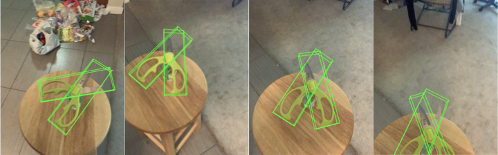

# 部署与感知路线

本文说明当前视觉部署的数据流、已完成事项和下一步工作。它取代 2026-10-28 旧版《REGRIND 真机视觉部署路线图》；旧版中的备选相机方案、物料清单和候选方法比较已过时。

## 已就绪的软硬件

**硬件与安装**：头部 D435（SN 348122072721）使用原装支架固定，标定和使用期间头部不动；Jetson 运行相机驱动，workstation 运行标定与感知工具。普通棋盘 DFOPTIX Q12-290-20（11×8 内角点、单格 20 mm）已实测并用于内参检查；后续视觉测试所需物料规格见下节。

**软件与数据链路**：D435 → Jetson 驱动（`tianji-wuji-retargeting` 部署仓库）→ Fast DDS（domain 0）→ workstation 上的 robot-perception。彩色流统一用 848×480@30 rgb8（运行时切换，部署默认 640×480），深度为 640×480 原生深度，align 关闭。任务侧数采把 D435 彩色记为 `observation.rgb.head`、深度记为 `observation.depth.head`。

**标定**：内参采用出厂值（fx 603.646、fy 603.362、cx 430.930、cy 245.467，D=0），经 19 幅手持棋盘检查后采用。外参由厂商 URDF、Intel D435 机械模型和驱动出厂 TF 拼接，经两个静态姿态的双臂叠图与原生深度核对后由用户签收，结果见 [extrinsics_base_link_20261110.json](../config/cameras/d435/extrinsics_base_link_20261110.json)，适用范围为头部固定、静态使用。工具包括 `robot-extrinsics-ui`、`rgbd-snapshot`、`arm-check`、`urdf_fk`；设置两个测试环境变量后，89 项测试全部通过。部署 DDS 修复已提交 GitLab `dev` 的 `0c5a648`。

**文档与模型资源**：当前首选任务见[水壶识别计划](object_recognition/kettleblack_plan.md)；算法候选与验证顺序见[物体识别与位姿估计：候选方案评估](object_recognition/algorithm_options.md)，早期深度调研见[相机场景候选技术栈扫描](object_recognition/camera_scenario_scan.md)。CAPTRA 官方代码和 SAPIEN 预训练权重已恢复到本机，供后续 articulated 扩展使用；权重尚未在本机 D435 数据上运行，详见下文"CAPTRA 模型资源"。

## 数据流

```text
D435 → Jetson 驱动 → /cameras/d435/{color,depth} + /tf_static
        ↓ Fast DDS（domain 0）
workstation / robot-perception
        ├─ 标定：内参检查、外参拼接与叠图核对（已完成）
        └─ 物体感知：detection / segmentation / 6D pose / tracking（未实现）

任务侧（tianji-wuji-retargeting 部署仓库）
        └─ 数据采集：observation.rgb.head = D435 彩色，observation.depth.head = D435 深度
```

## 阶段

- **A. 标定包迁移**：已完成。标定代码只在本仓库维护，REGRIND 中的旧脚本已删除。
- **外参**：已完成并签收，范围限定为头部固定、静态使用；时间同步未验证。
- **B. 物体感知离线基线**：未开始，当前首选刚性水壶，实施顺序见[水壶识别计划](object_recognition/kettleblack_plan.md)和下文“验证逻辑与证据口径”。开始前需由用户冻结数据集与 train/heldout 划分、模型及 license、GPU 与下载预算、数值阈值。先选一个可核验的基线，不叠加多个模型；model-based pose 先用人工核对的 mask 和米制 mesh 单独检查位姿，再接入自动分割。
- **C. 消费者接入**：标定文档已切换到本仓库；物体观测与实时接入未实施，实时部分须另行批准 camera-only 工单。每条观测需包含源时间戳与 clock domain、frame_id、内参/标定/算法/资产版本、object ID 和有效性或失败原因；过期、丢失或未标定的观测标为无效，不用 identity pose 填充。

## 视觉测试物料与测量

以下为视觉测试需要准备的物料与测量规格。当前内参检查使用的是普通棋盘 DFOPTIX Q12-290-20（11×8 内角点、单格 20 mm），ChArUco 与 AprilTag 规格供后续测试选用。所列尺寸用于下单和后续实测，不代表已经达到标定精度；通用件可直接采购，tianji 末端转接板必须等末端安装接口尺寸确认后定制。

1. **ChArUco 标定板两块**：采用 OpenCV `DICT_6X6_250`，哑光表面、约 3 mm 厚硬质铝塑板。大板建议 600 × 800 mm，9 × 12 格，square size 50 mm、marker size 37 mm、marker IDs 0–53；小板建议 A3，7 × 10 格，square size 30 mm、marker size 22 mm、marker IDs 100–134。供应商须随板交付 dictionary、marker IDs、生成参数和矢量源文件，原尺寸输出，禁止缩放打印。
2. **AprilTag 贴纸一套**：tag36h11，ID 0 与 ID 1 分别对应两片剪刀连杆；20、30、40 mm 三种尺寸，每个 ID、每种尺寸各 10 张。尺寸统一定义为检测角点对应的黑色外框边长，不含白色静区；图案周围保留白色静区，不得裁入黑框。选择哑光、薄型、低残胶材质，正式测试从不妨碍抓取且图像角点稳定的最大尺寸开始。
3. **尺寸量具一套**：0–150 mm 数显卡尺一把，分辨率 0.01 mm、准确度 ±0.03 mm 或更高并附校准证书；300 mm 钢尺一把。用于实测标定板方格、AprilTag 黑色外框边长、剪刀尺寸与铰链位置，配置中填写实测值而非只填标称值。
4. **角度参照一套**：0–360° 双臂数字量角器一把，分辨率 0.05° 或更高、准确度 ±0.2° 或更高并附校准证书，配可重复定位的机械挡块或夹具，用于独立检查剪刀零位和若干固定开合角。
5. **标定板夹具**：现有这一套即可，用于需要固定标定板的后续测试。

到货后先检查板面平整与哑光效果、dictionary 和 marker IDs 与订单一致、图案无缩放、白色静区完整、tag ID 正确、量具校准证书齐全和支架无可见松动，再把方格与标记的实测尺寸写入标定配置并记录版本。第 1–4 项到位后即可开始 D435 内参/配准复核、标记检测、静态位姿重复性与开合角对照检查；绝对位姿精度须等机器人运动学参照经校验或另配独立位姿计量方案后再评定。机器人侧固定件用于后续手眼标定和动态任务测试。

## 验证逻辑与证据口径

按“先分割、再位姿、后集成”的顺序验证，每一步只更换一个主要变量，便于区分分割、位姿和接口问题。

- **B1：SAM 3 文本分割**。在真实 D435 图像上验证水壶的零样本 mask，记录实例选择、把手/壶盖/壶身边界完整性、失败类型和单帧延迟。
- **B2：Eagle 回退**。只在 SAM 3 定位失败的样本上测试 Eagle box → SAM 3，确认有稳定收益才保留。
- **B3：FoundationPose 根位姿**。先用人工确认的 mask 验证水壶米制 mesh、深度和位姿链路，再接入自动 mask；用留出视角评估平移、旋转和跟踪丢失。
- **B4：articulated 扩展（后续）**。剪刀等可开合物体再比较 CAPTRA 与分部件 FoundationPose；CAPTRA 使用已恢复的官方 SAPIEN 权重，路径见下文"CAPTRA 模型资源"。水壶无铰链，不涉及这一阶段。
- **B5：Isaac ROS 集成**。原生离线基线可用且部署确定采用 ROS 2 后，再比较集成收益、资源占用和端到端延迟。

数据集和 train/heldout 划分在评测前固定。按固定标注与分母报告检测/分割成功率、位姿平移与旋转误差、跟踪丢失率、延迟分布和资源用量；失败样本、对称物体和无有效深度样本分开报告。每次运行归档原始 RGB-D、机器人状态、估计结果、时间戳以及标定、资产和算法版本；成功定义、材料、允许差距和剔除规则在正式对比前冻结。

## CAPTRA 模型资源

可复用的官方预训练权重：`/home/daisy/robot-perception-data/models/captra/sapien_ckpt.tar`，其中包含 `scissors_rot/ckpt/model_0000.pt` 和 `scissors_coord/ckpt/model_0000.pt`。

CAPTRA 论文中的实采剪刀轨迹示例（Figure 3，arXiv:2104.03437）：




## 边界与风险

头部固定是外参成立的前提；头部、支架、相机、URDF 或驱动变化后必须重新核对。单主视角的手部遮挡、金属刃面深度缺失、运动模糊需在具体任务上测量。水壶模型已复制到本机，尺度、把手和实物状态待核对；剪刀等 articulated 资产后续再建。图像与机器人状态的时间同步未验证。eth0 和 eth10 的重复 IP 属于网卡配置问题，需部署负责人处理。
