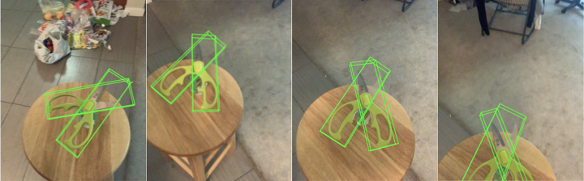

# REGRIND 真机视觉部署路线图（v7.0，2026-10-28）

> 执行入口：ARCTIC scissors 的具体实机路线以 REGRIND 的 [`arctic_scissors_real_deployment.md`](../../regrind-vision-deploy/REGRIND/docs/vision-deploy/arctic_scissors_real_deployment.md) 为准。本文已迁入 robot-perception，保留原系统架构、方法候选与风险背景，不作为通用感知仓库的任务执行授权；跨仓库链接仅适用于本机相邻 checkout。

> 本版按 2026-10-28 确认的硬件方案整体重写：以固定安装在 tianji 头部的 RealSense D435 为默认主相机，其余相机按重建、标定、评测或补视角需要灵活使用；已购实体剪刀进入 3D 重建、仿真资产、训练与真机任务全流程。原“双 ZED 2i 固定机位 + 偏振套件”不再是部署前提。
>
> 本文记录该版部署目标、资源边界、系统架构、验证逻辑、分工与风险。对应训练记录见 REGRIND 的 [tactidex_8seq_training_20261017.md](../../regrind-vision-deploy/REGRIND/docs/tactidex/tactidex_8seq_training_20261017.md)；相机方法与硬件候选的历史调研见 [camera_scenario_scan.md](camera_scenario_scan.md)，其中“已暂定双 ZED 2i”的表述以本版决策为准。当前通用标定步骤与实物配置状态见[标定流程](calibration_workflow.md)，不以本页历史采购建议替代实测值。

## 1. 目标与判据

在 tianji 臂 + Wuji Hand 2 上，以头部 D435 为主视角替换动捕，向策略实时提供实体剪刀的整体 6DoF 位姿与开合角。策略的观测/动作契约和机器人控制结构保持不变，但允许按实体剪刀资产与实测视觉噪声重新生成训练数据并重训 checkpoint。

最终判据是使用已购实体剪刀剪断正式实验前冻结的材料，且计入成绩的回合不以动捕或标记解算结果作为控制输入。默认交付先验证“头部 D435 单主视角”配置；若辅助相机进入闭环，必须作为独立配置重新冻结观测契约、同步方案和验收结果，不能与单主视角结果混报。

中间判据是视觉入环后的任务成功率相对“准确状态基线”的下降不超过书面冻结的允许差距，同时报告轨迹误差、观测误差与端到端延迟。本文不在实验前宣布 FoundationPose 或任一角度估计方案已通过真机验证，也不预设辅助相机的型号、数量和固定机位。

## 2. 硬件设定

硬件设计按 D435 与 tianji 头部刚性连接处理，初始标定必须验证安装稳定性、线缆随动和工作视野，并同步确认头部是否运动、可用关节状态及时间戳能力；这些事实决定外参是常量还是必须随头部正运动学逐帧更新。

## 3. 已就绪的与要新建的

已就绪的资源包括：策略训练管线（TactiDex 重定向 → RL 训练 → checkpoint）；根位姿主线与开合角候选清单；tianji 臂与 Wuji Hand 2（既有记录确认可反驱）；头部 D435；实体剪刀；剪刀贴标许可。实体剪刀已购只表示重建与实验对象到位，不表示其 mesh、铰链或物理参数已经校准。

要新建五项交付物。

1. **部署软件栈**：D435 采集与时间戳、策略推理节点、机器人适配层、状态估计节点、标记解算节点，以及统一的观测质量与延迟记录。
2. **头部相机标定与坐标变换**：RGB/depth 各自内参与空间配准、RGB/depth 帧配对、相机到头部的外参、头部关节状态到任务坐标系的变换，以及图像与机器人状态的软件时间对齐。
3. **实体剪刀 articulated 资产**：双连杆 visual/collision mesh、铰链轴与关节约定、URDF/USD、关键点、尺度和物理参数，供重定向、仿真与位姿估计共同使用。
4. **标定与评测参照**：留出视角标定、标记解算精度评测、原始数据归档、固定试验协议和真剪切判据。
5. **D435 数据侧配套**：按实测 RGB、深度缺失、遮挡、标定误差与延迟分布建立噪声模型，完成带噪重训和固定协议仿真评测。

### 初始标定与视觉测试物料清单

以下按“一台头部 D435 + 两片剪刀标记”的首轮测试配置给出采购规格。所列尺寸用于下单和后续实测，不代表已经达到标定精度；通用件可直接采购，tianji 末端转接板必须等末端安装接口尺寸确认后定制。

1. **ChArUco 标定板两块**：采用 OpenCV `DICT_6X6_250`，哑光表面、约 3 mm 厚硬质铝塑板。大板建议 600 × 800 mm，9 × 12 格，square size 50 mm、marker size 37 mm、marker IDs 0–53；小板建议 A3，7 × 10 格，square size 30 mm、marker size 22 mm、marker IDs 100–134。供应商须随板交付 dictionary、marker IDs、生成参数和矢量源文件，原尺寸输出，禁止缩放打印。
2. **AprilTag 贴纸一套**：tag36h11，ID 0 与 ID 1 分别对应两片剪刀连杆；20、30、40 mm 三种尺寸，每个 ID、每种尺寸各 10 张。尺寸统一定义为检测角点对应的黑色外框边长，不含白色静区；图案周围保留白色静区，不得裁入黑框。选择哑光、薄型、低残胶材质，正式测试从不妨碍抓取且图像角点稳定的最大尺寸开始。
3. **尺寸量具一套**：0–150 mm 数显卡尺一把，分辨率 0.01 mm、准确度 ±0.03 mm 或更高并附校准证书；300 mm 钢尺一把。用于实测标定板方格、AprilTag 黑色外框边长、剪刀尺寸与铰链位置，配置中填写实测值而非只填标称值。
4. **角度参照一套**：0–360° 双臂数字量角器一把，分辨率 0.05° 或更高、准确度 ±0.2° 或更高并附校准证书，配可重复定位的机械挡块或夹具，用于独立检查剪刀零位和若干固定开合角。
5. **靶标与相机支撑一套**：重型三脚架一个、标定板刚性夹具一套、1/4-20 连接件两套；辅助相机按实际启用数量配独立三脚架或夹臂，首轮可先备两套。
6. **机器人侧固定件一套**：刚性靶标支架一套，tianji 末端转接板按已确认的末端安装接口尺寸定制。通用夹具可先购，末端转接板未到位不阻塞 D435 的 RGB/depth 配准、标记检测与静态重复性实验。

到货后先检查板面平整与哑光效果、dictionary 和 marker IDs 与订单一致、图案无缩放、白色静区完整、tag ID 正确、量具校准证书齐全和支架无可见松动，再把方格与标记的实测尺寸写入标定配置并记录版本。第 1–4 项到位后即可开始 D435 内参/配准复核、标记检测、静态位姿重复性与开合角对照检查；绝对位姿精度须等机器人运动学参照经校验或另配独立位姿计量方案后再评定。第 5–6 项用于后续头相机外参、手眼关系和动态任务测试。

## 4. 关键术语

- **头部主视角**：D435 固定于 tianji 头部，属于 eye-in-head 配置，不是固定在手腕上的 eye-in-hand。它能直接复用现有头部安装位置，但其视野、遮挡和运动模糊必须在实际任务轨迹上测量。
- **主相机与辅助相机**：主相机默认提供在环 RGB-D；辅助相机可用于离线重建、独立标定或评测参照。辅助相机只有在单主视角实测不足并单独批准配置后才进入控制环。
- **根位姿**：剪刀整体参考系相对任务坐标系的 6DoF 位姿。FoundationPose 是根位姿估计主线，默认使用锚定剪刀根坐标系的根连杆刚性 mesh 与 RGB-D；若改用固定参考开合角的整体刚性 mesh，必须作为另一模型配置在全关节范围单独验收。实测精度取决于模型质量、深度有效性和遮挡情况。
- **标记解算**：剪刀两片各贴一张 ChArUco/AprilTag 贴纸，相机检测后由 solvePnP 求每片标记的 6DoF 位姿，再经“贴纸到所属连杆”和“根连杆到剪刀根坐标系”的标定外参求根位姿，由两片相对位姿绕已标定铰链轴求开合角。它是需要贴纸的几何参照，不是最终无标记估计结果。
- **准确状态基线**：由经过精度评测的标记解算提供全部剪刀状态，用于先验证实体资产、策略和机器人本体。这里的“准确”是相对于待考核学习估计器的实验参照，不代表免除标记误差测量。
- **参照与估计器**：标记解算与学习型估计器在平行录制阶段同时输出；前者提供评测参照，后者提供 FoundationPose 根位姿和无标记开合角，两路逐帧对齐后才能归因误差。
- **实体 articulated 资产**：从已购剪刀重建的两个刚性部件及其 revolute joint，包含统一尺度、坐标原点、关节零位/方向/限位和碰撞几何。整体刚体 mesh 不能替代该资产。
- **CAPTRA**（arXiv:2104.03437，ICCV 2021）：category-level 位姿跟踪方法，输入深度点云，先用上一帧位姿归一化当前点云，再逐部件估计 6DoF 位姿与关节角。选它作无标记开合角候选，是因为训练类别包含 scissors，论文给出 Kinect2 实采剪刀轨迹结果，且官方代码与预训练权重已发布。已知约束包括论文报告约 12 FPS、依赖类别先验与物体 mask、Python 3.7/PyTorch 1.6 旧环境兼容成本，以及尚未确认的 license。训练数据规模与真实轨迹证据分别见论文 §5 和 Figure 3，代码与权重见官方仓库 README。



- **观测延迟**：从相机曝光到策略实际读到对应状态的时差，包含读出、传输、估计、坐标变换和观测排队；机器人执行延迟另行测量。
- **允许差距**：每个视觉替换步骤在正式实验前书面冻结的成功率下降上限，冻结后不根据结果放宽。

## 5. D435 主视角与可选辅助相机架构

头部 D435 是默认在环传感器，其余相机不再构成系统启动前提。主数据流与参照数据流必须分开记录，避免评测参照未经声明进入控制输入。

```text
实体剪刀 → 头部 D435（RGB-D + RGB/depth 原始时间戳）
                    ↓
          状态估计（根位姿 + 开合角）
                    ↓
头部关节状态 + 头相机外参 → 任务坐标系变换
                    ↓
          观测组装 + 质量/延迟标志 → 策略 → 机器人适配层 → tianji + Wuji Hand 2

标记解算 / 可选辅助相机 → 平行参照、离线重建、标定与评测
                         → 只有获批的补视角配置才接入观测组装
```

头部相机的坐标变换必须覆盖头部运动。令 \(B\) 为任务基座坐标系，\(H\) 为头部坐标系，\(C\) 为 D435 坐标系，\(O\) 为剪刀根坐标系，则

\[
{}^{B}T_C(t)={}^{B}T_H(q_{\mathrm{head}},t)\,{}^{H}T_C,\qquad
{}^{B}T_O(t)={}^{B}T_C(t)\,{}^{C}T_O(t).
\]

其中 \({}^{H}T_C\) 由固定安装外参标定给出，\({}^{B}T_H\) 由头部正运动学给出；若头部机械固定，也要用实测确认该项可否视为常量。默认 \(C\) 取 color optical frame，depth 对齐到 color 后使用对应 color 内参；若在 depth optical frame \(D\) 中估计，必须显式记录 \({}^{C}T_D\) 并变换回 \(C\)。初始标定还要冻结 RGB/depth 帧配对时间差上限并验证空间配准，保留两路原始曝光时间戳；相机与头部关节状态必须按曝光时刻对齐，不能只用图像到达计算机的时间代替。

初始可观性实验必须覆盖接近、抓取、开合和剪切四个阶段，分别记录手柄、铰链与刃面的 RGB 清晰度、深度有效率、手部遮挡和丢失时长。若单主视角不满足预先冻结的要求，按“调整头部任务姿态与曝光 → 评估单目 RGB 备选 → 引入辅助视角”的顺序分支；每个分支都要重新测量延迟和任务性能。

辅助相机的使用分两类。离线用于实体重建或独立参照时，不改变策略观测契约；但对运动物体做离线定量评测仍需要跨相机外参、共同时间基准和逐帧对应。在线用于补视角或融合时，必须增加相机外参、时间同步、遮挡处理和故障降级设计，并以独立配置名称报告结果。

## 6. 实体剪刀重建、资产入库与训练配套

实体剪刀是几何、物理参数和真机评测的共同来源，不再只作为最终测试道具。第一优先级是完成已购主实例的可复现资产，跨实例扩展在实物数量确认后安排。

资产管线按以下顺序执行。

1. **实物建档与测量**：记录 object ID、型号、照片、整体尺寸、质量、铰链位置、关节零位、开合方向和机械限位；保存标记贴纸尺寸及粘贴位置，标定并版本化每张贴纸到所属连杆、根连杆到剪刀根坐标系的固定外参，避免把贴纸厚度误并入工具几何。
2. **多视角与多关节角采集**：以头部 D435 为必采视角，其余相机按重建质量自由选择，采集多个开合角下的 RGB-D、标定数据与实物状态；原始帧、相机参数和采集配置一并归档。
3. **双部件重建与铰链标定**：分别生成两片 visual mesh，在统一尺度下对齐铰链，构建 bottom/top 两连杆与 revolute joint。Articulate-Anything 等自动结果只能作为候选，必须经过实物尺寸和留出视角校验后再入库。
4. **统一资产导出**：生成 visual/collision mesh、供 FoundationPose 使用的根连杆刚性 mesh、URDF/USD、物体关键点与元数据，明确根连杆、米制尺度、根坐标系、关节轴向、零位、方向和限位；同一 object ID 贯穿重定向、RL、FoundationPose 和真机日志。
5. **几何验收**：用实物测量、未参与重建的视角和关节扫描检查轮廓/深度叠合、铰链一致性、部件穿透与碰撞几何；在多个开合角下验收根位姿刚性模型，并检查由标记到根坐标系的完整变换链；具体误差上限在正式评测前冻结。
6. **物理与视觉配套**：测量质量、质心与摩擦等参数，通过真机回放校准 sysID；再将 D435 实测的深度缺失、噪声、遮挡、外参扰动和延迟分布接入仿真，重生成剪刀训练集并完成带噪重训。

实体主实例同时用于准确状态基线、平行录制、估计器对比和最终真剪切。若后续增加剪刀变体，每个实例必须拥有独立 object ID 和资产验收记录，不能用主实例的重建结果替代其他实物。

## 7. 验证逻辑与证据口径

验证顺序是先证明实体资产与本体控制可行，再依次替换根位姿和开合角来源。直接从准确状态跳到全无标记视觉会把资产、接触、位姿、角度和延迟故障混在一起，因此每一步只更换一个主要变量，并保留上一阶段的可用配置。

- **阶段 A：观测、资产与策略检查**。先确认 D435 视野、标定和实体资产达标；每个新 checkpoint 还须通过固定协议仿真并冻结资产与 checkpoint 版本，再进入真机，以免用策略试验排查基础几何问题。
- **阶段 B：准确状态基线**。标记解算供全部物体状态，验证新实体资产、策略和机器人本体；失败时先区分状态参照误差、资产/接触问题和控制问题。此后每次重训都必须用新 checkpoint 重测准确状态基线，不能沿用重训前的对照。
- **阶段 C：根位姿视觉化**。只把根位姿切换为 FoundationPose，开合角仍由标记解算提供，并与同一资产、同一 checkpoint 的准确状态基线比较；不通过时退回阶段 B 并处理模型、深度或标定误差。
- **阶段 D：开合角无标记化**。在相同数据上比较 CAPTRA 与分部件 FoundationPose，并用仿真鲁棒曲线确定策略容忍度；两者均不达标时，阶段 C 是正式降级交付。
- **阶段 E：完整视觉交付**。控制输入不再使用标记解算，标记与辅助相机只作独立评测参照；辅助相机入环的配置另列，不计入 D435 单主视角结果。

真机试验每个配置至少 20 次，分两个独立场次；基线与视觉配置采用配对场次和相同初始条件分布，报告成功次数、置信区间和失败原因。正式对比前冻结成功定义、材料、允许差距与剔除规则，试验后不得按结果改变口径。

每次试验必须归档原始 RGB-D、机器人状态、两路估计、时间戳、标定版本、资产版本、checkpoint 与控制输入来源。自动标定和几何检查只证明对应指标，不替代真机任务与材料实际剪断的人工验收；所有结论必须能区分计划、离线结果和真机结果。

## 8. 分工

daisy 负责总集成与真机侧交付：tianji 臂、Wuji Hand 2 和头部 D435 的安装/线缆/急停；相机驱动、时间同步与标定；实体测量和多视角采集；部署软件栈；重定向与训练生产、D435 噪声模型与重训；实机评测和本文维护。

yuxin 负责仿真与资产侧四项交付：① 实体剪刀双部件重建、铰链标定、关键点与 URDF/USD 入库；② 碰撞几何、质量、质心和摩擦的 sysID，并与真机回放对比；③ D435 相机仿真、深度缺失/遮挡/标定/延迟噪声接入；④ 固定协议仿真评测、鲁棒曲线与报告格式。

双方在首次正式实验前共同冻结接口与检查阈值，在主实例资产入库时共同签收。任务按接口契约领取，任何辅助相机入环或资产定义变化都要同步更新契约和版本记录。

## 9. 风险与退路

- **准确状态基线不通过（最高风险）**：实体重建可针对既有论文所述 mesh 不准问题，但不能预先证明接触与控制已经可行；阶段 B 失败时先保持视觉方案不变，分别检查参照、资产、接触和本体。
- **金属刃面导致 D435 深度缺失**：主动 RGB-D 仍可能受反光和薄结构影响，因此初始可观性实验必须分手柄、铰链和刃面量化；不达标时依次评估视角/曝光调整、单目 RGB 备选和辅助相机，不把偏振套件当作默认解法。
- **头部单视角遮挡或运动模糊**：手掌、手指和臂可能遮住铰链或刃口，头部运动会改变视角；按任务阶段统计可见时长，必要时调整头部任务姿态或启用独立辅助视角配置。
- **头部外参与时间同步误差**：安装松动、头部运动或图像/关节时间错位会直接转化为根位姿误差；每次正式场次前检查安装与标定版本，并保存随帧关节状态和曝光时间戳。
- **实体 articulated 资产误差**：整体重建正确并不代表双连杆与铰链正确；留出视角、关节扫描和碰撞检查任何一项不通过，都不得进入阶段 B。
- **无标记角度方案不达标**：CAPTRA 与分部件 FoundationPose 都可能受深度、遮挡或 domain gap 限制；退路是保留“FoundationPose 根位姿 + 标记角度”的阶段 C 正式配置。
- **延迟超标**：相机帧率不等于策略实际更新率，必须分段测量曝光、传输、推理、排队和执行延迟，再决定滤波与同步策略。
- **跨实例证据不足**：只有一把实体剪刀时，交付结论只覆盖该实例；变体结果必须在取得并验收更多实物后补充。
